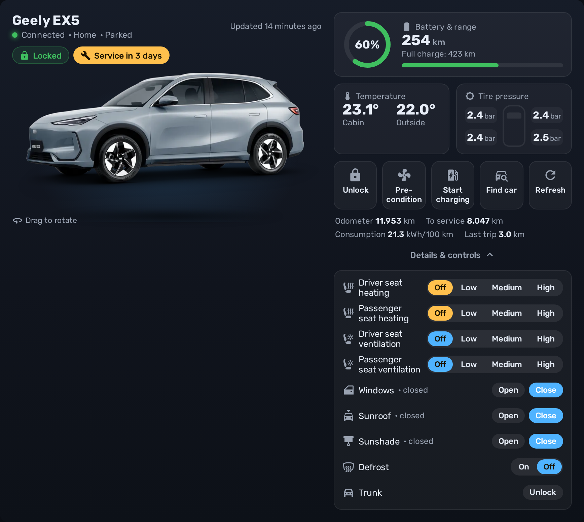
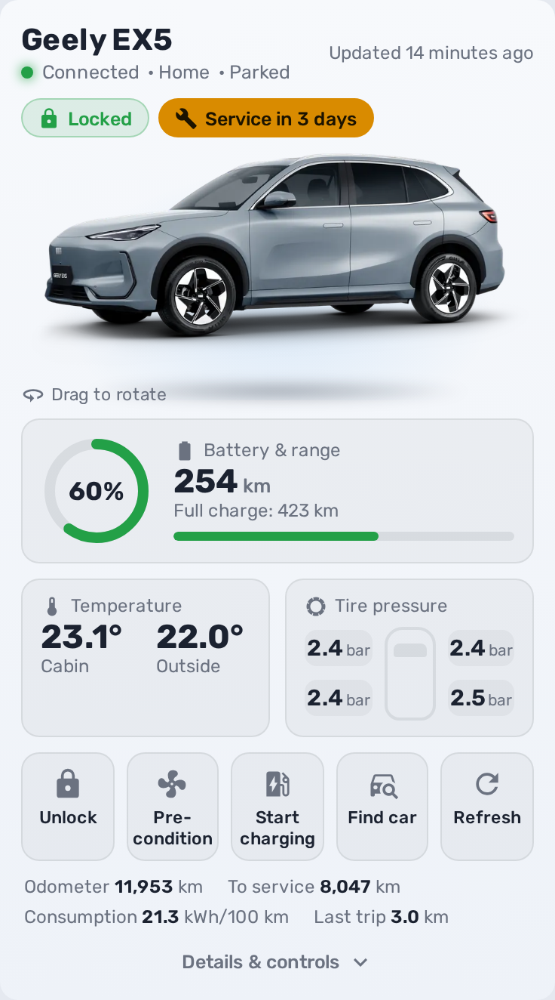
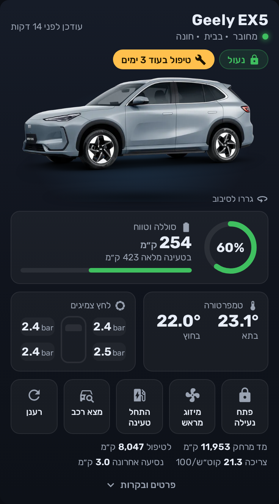
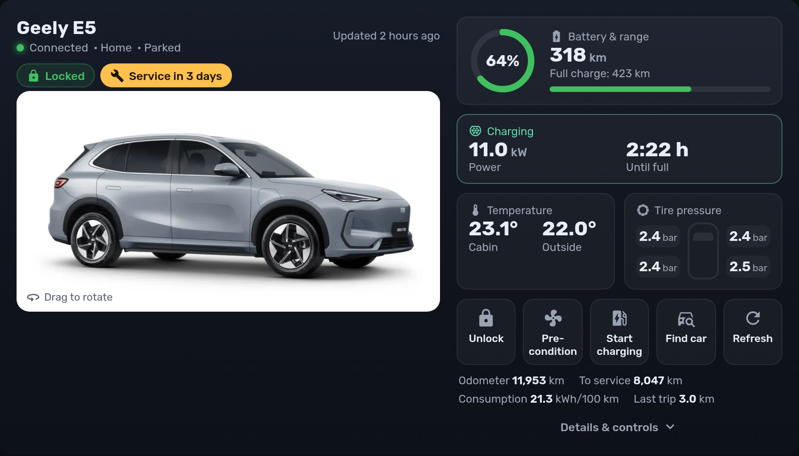
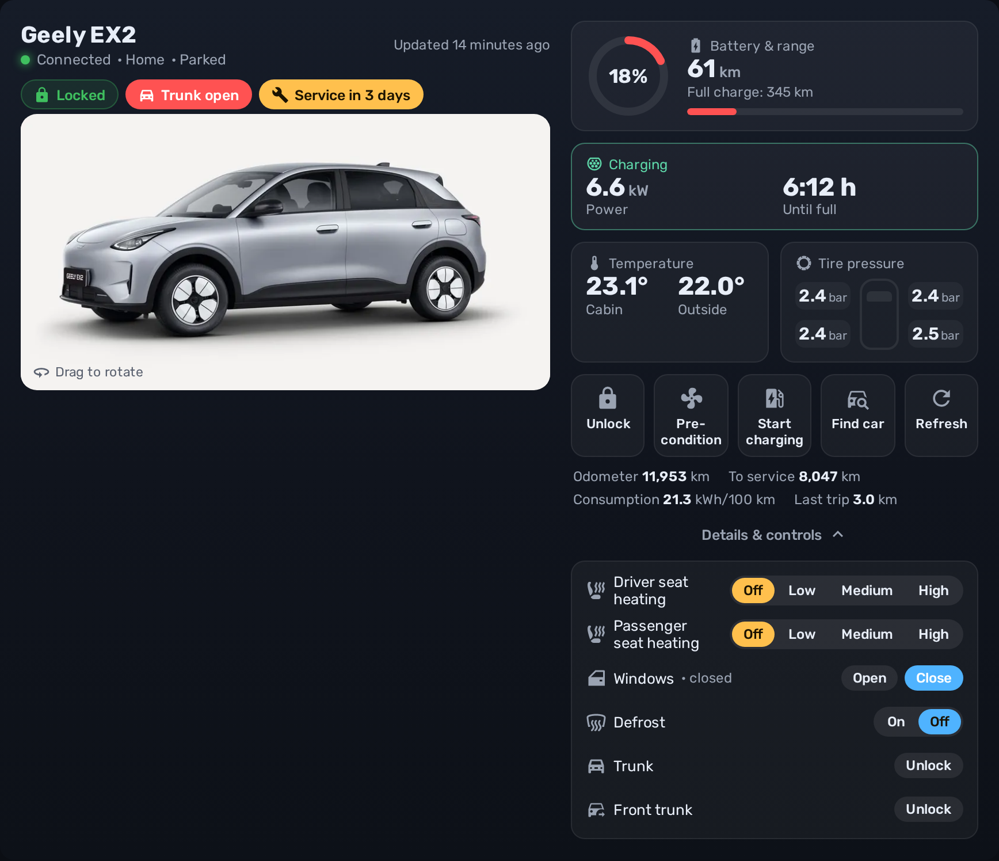
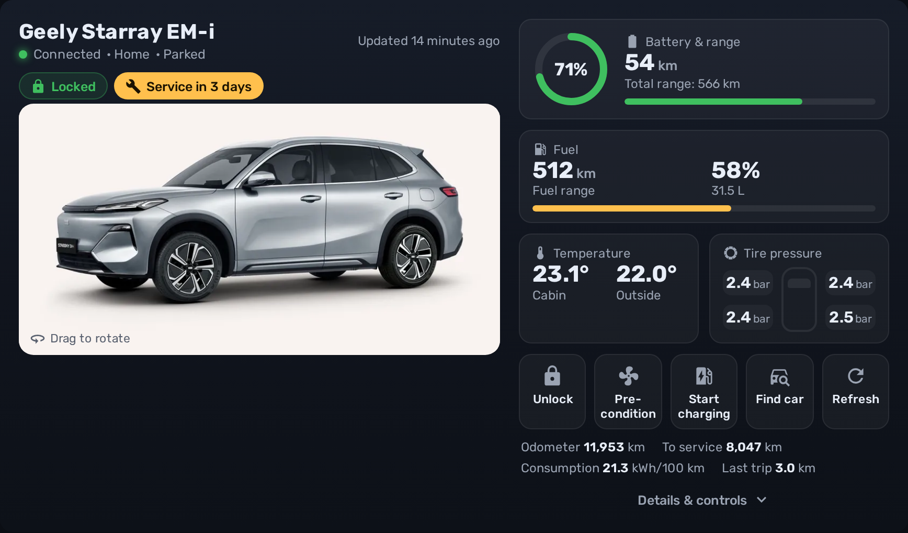
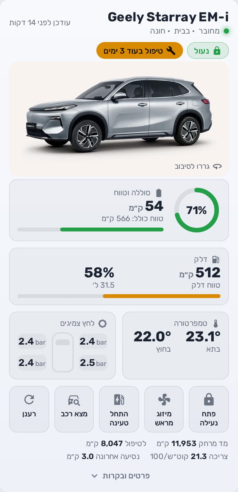

# Geely 3D Card

A polished Lovelace card for **Geely** cars in Home Assistant – built for the **EX5**, and also supporting the **E5**, the **EX2 / E2 / EX2 Max** and the **Starray EM-i (PHEV)** – with a **drag-to-rotate 360° view** of the car, battery & range, fuel (PHEV), charging, tire pressures, climate, lock and quick controls. Full **English** and **Hebrew (RTL)** UI.

It is a front-end for the excellent **[Geely Connect](https://github.com/YossiKon/geely-connect)** integration by **[@YossiKon](https://github.com/YossiKon)** – all the car data and commands come from that integration (see [Credits](#credits)).

> **Unofficial.** This card is a community project. It is not affiliated with, endorsed by, or supported by Geely. Car images are © Geely, downloaded by you from [geely.com](https://www.geely.com/) / [geely.com.au](https://www.geely.com.au/) / [geely.de](https://www.geely.de/), and are not part of this repository.


## Credits

- **Integration:** [Geely Connect](https://github.com/YossiKon/geely-connect) (`geely_connect`) by [@YossiKon](https://github.com/YossiKon) – the unofficial Home Assistant integration that talks to Geely's cloud and creates every entity this card reads and controls. Issues with data or commands belong in [its issue tracker](https://github.com/YossiKon/geely-connect/issues). Per its source, its protocol mappings build in part on [nitaybz/geely-global-ha](https://github.com/nitaybz/geely-global-ha).
- **Car images:** the 360° frames come from Geely's own websites – [geely.com](https://www.geely.com/en/models/ex5) (EX5), Geely Europe's [geely.de](https://www.geely.de/models/geely-e5-electric-suv) (E5) and [geely.com.au](https://www.geely.com.au/) (EX2, Starray EM-i). They are © Geely and are fetched locally by `scripts/fetch-images.sh`; they are not redistributed here.
- **Icons:** [Material Design Icons](https://pictogrammers.com/library/mdi/) via Home Assistant's `ha-icon`.

## Features

- 360° car view: drag (mouse or touch) through 24 frames with momentum; vertical page scrolling still works on phones
- Per-model profiles with automatic model detection (from the device in the device registry)
- Battery ring (color by level), electric range and range at full charge
- **PHEV:** fuel tile (fuel %, litres, fuel range) and total combined range; fuel-flap-open warning
- Charging panel (power, time to full) – shown only while plugged in / charging
- Optional **charger control**: Start/Stop buttons for a wall charger in Home Assistant (any integration), with confirmation. Hidden unless you configure the entities
- Lock state with lock / unlock button (unlock asks for confirmation)
- Red warning chips for open doors, trunk, hood, windows, sunroof and fuel flap
- Service warning chip (days or km to service)
- Tire pressures in **bar** by default (or `psi` / `kPa` via `tire_unit`) on a small top-view diagram, low pressure highlighted (sensors in psi / kPa / bar are converted automatically)
- Cabin and outside temperature
- Quick actions: pre-conditioning panel (temperature, Rapid Cooling / Rapid Warming, seats, defrost, optional scheduled start), start/stop charging (with confirmation), find car (opens a map with the car's location, or honk & flash), refresh data
- Expandable details: seat heating & ventilation (front and rear, where the car has them), windows, sunroof, sunshade, defrost, unlock trunk, unlock **frunk** (EX2 / E2)
- Every block hides itself when the car does not have the entities – so trims without a sunroof or ventilated seats, and unknown models, just work
- Tap any value to open the entity's more-info dialog
- English (LTR) and Hebrew (RTL) – automatic from your HA language, or forced
- Light and dark theme, responsive (one column on phones, two columns on wide sections)
- Vanilla web component: no build step, no external dependencies

## Supported models

The integration is owner-tested on the EX5, the EX2 (sold as the E2 in some markets, plus the EX2 Max) and the Starray PHEV (Starray EM-i), and is capability-driven, so other Geely models on the Geely Global / International app should work too ([integration README](https://github.com/YossiKon/geely-connect#readme)). The card mirrors that:

| Model (`model:`) | Drive | 360° view | Image source | Colors (`color:`) |
|---|---|---|---|---|
| Geely EX5 (`ex5`) | BEV | ✅ 24 frames, transparent | geely.com | `silver` (light gray), `grey`, `green`, `black`, `white` |
| Geely E5 (`e5`) | BEV | ✅ 24 frames, white studio background | geely.de (Geely Europe) 360° viewer | `silver`, `gray`, `white`, `black`, `green` |
| Geely EX2 / E2 / EX2 Max (`ex2`) | BEV | ✅ 24 frames, studio background | geely.com.au configurator | `moon-white`, `nebula-beige`, `star-silver`, `aurora-green`, `nova-pink`, `comet-grey` |
| Geely Starray EM-i (`starray_emi`) | PHEV | ✅ 24 frames, studio background | geely.com.au configurator | `alpine-white`, `polar-black`, `jungle-green`, `glacier-blue`, `volcanic-grey`, `cloudveil-silver` |
| Any other Geely (`generic`) | auto (fuel tile appears if fuel entities exist) | ➖ single image via `car_image`, or your own frames via `image_base` + `frames`; otherwise a car icon | – | – |

Notes on partial support:

- **EX2 and Starray EM-i** frames come from Geely Australia's configurator and are opaque JPGs on a light studio background (no transparent set is published). The card draws them on a matching rounded panel. `--remove-background` in the fetch script is an experimental cut-out.
- **E5** is the name the EX5 is sold under in Europe and Israel (in China: Galaxy E5). Its frames come from Geely Europe's 360° viewer and show the "GEELY E5" badge; they are opaque JPGs on a white studio background, drawn on a white panel. If your car shows up as an EX5 in the integration, set `model: e5` to use these images. Colors: `silver` (Moonlight Silver), `gray` (Frost Grey), `white` (Snow White), `black` (Carbon Black), `green` (Turquoise Green). The E5 profile has only been checked with simulated data.
- **EX2 Max / E2** use the EX2 images – no separate 360° sets are published for them.
- The **Starray** on geely.com's global site is a different, petrol-only car, so its 360° set is not used for the Starray EM-i.
- Cars on the integration's experimental **new Geely EM (Zeekr) platform** get fewer entities. The card simply hides what is missing.
- The EX5 profile has been run against a real car. The EX2 and Starray EM-i profiles have only been checked with simulated data built from the integration's entity names.

## Requirements

- Home Assistant 2024.x or newer
- The **[Geely Connect](https://github.com/YossiKon/geely-connect)** custom integration (domain `geely_connect`) with your car added
- The car images (see [Car images](#car-images)) – they are **not** included in this repository

## Installation

### Marketplace (Home Assistant 2026.11+)

[](https://my.home-assistant.io/redirect/hacs_repository/?owner=1immortal&repository=geely-3d-card&category=plugin)

Once the card is in the default catalog:

1. **Settings → Marketplace**, search for **Geely 3D Card**, open it, install it, then reload the browser.
2. The resource `/local/community/geely-3d-card/geely-3d-card.js` is registered automatically.

If it does not appear in search yet, add it by link: **Settings → Marketplace → Add from link**, enter `1immortal/geely-3d-card` (type **Dashboard**, if asked), then install as above.

### HACS (Home Assistant 2026.10 and older)

Once the card is in the default store, search for **Geely 3D Card** in HACS, install it, then reload the browser. HACS registers the resource `/hacsfiles/geely-3d-card/geely-3d-card.js` automatically.

If search does not find it, add it as a custom repository first: HACS → ⋮ → **Custom repositories** → add `https://github.com/1immortal/geely-3d-card`, category **Dashboard**, then install as above.

### Manual

1. Copy `geely-3d-card.js` to `/config/www/geely-3d-card.js`.
2. Settings → Dashboards → ⋮ → **Resources** → add `/local/geely-3d-card.js` as **JavaScript module**.
3. Reload the browser.

The previous type `custom:geely-ex5-card` is still registered as a backward-compatible alias, so existing dashboards keep working after the upgrade.

## Car images

The frames are © Geely, so they are not distributed here. The included script downloads them for your own use, crops them and converts them to 900 px WebP (about 0.4–1 MB per color):

```bash
scripts/fetch-images.sh --list                                   # models and their colors
scripts/fetch-images.sh --model ex5 --color silver               # -> ./images/ex5/silver/1.webp … 24.webp
scripts/fetch-images.sh --model e5 --color silver                # -> ./images/e5/silver/1.webp … 24.webp
scripts/fetch-images.sh --model ex2 --color star-silver          # --variant N picks another trim's set
scripts/fetch-images.sh --model starray_emi --color glacier-blue # --remove-background (experimental)
# or directly: python3 scripts/fetch_images.py … (needs Pillow)
```

Copy the folder to Home Assistant as **`/config/www/geely-ex5/<model>/<color>/`** (File editor, Samba or SSH add-on), so the files are served at `/local/geely-ex5/<model>/<color>/1.webp`. That is the card's default location for the detected `model` and `color`. If you store them anywhere else, set **`image_base`**.

EX5 and E5 frames: 1 = front, 7 = left side, 13 = rear, 19 = right side. The Geely Australia sets run the other way, and the profile handles that (`rotate_direction`).

## Configuration

Find your **entity prefix**: open any entity of the car, e.g. `lock.my_geely_ex5_1234_doors` → the prefix is `my_geely_ex5_1234` (everything between the domain and `_doors`).

| Option | Type | Default | Description |
|---|---|---|---|
| `type` | string | **required** | `custom:geely-3d-card` |
| `entity_prefix` | string | **required** | Shared prefix of the car's entities, e.g. `my_geely_ex5_1234` |
| `model` | string | `auto` | `auto`, `ex5`, `e5`, `ex2`, `starray_emi` or `generic`. Auto-detection reads the car's device (model / name) in the device registry, then the prefix |
| `language` | string | `auto` | `auto` (Hebrew if your HA language is Hebrew, otherwise English), `en` or `he` |
| `title` | string | model name | Card title |
| `climate_entity` | string | auto-detected | Pre-conditioning climate entity. Auto-detection looks for `climate.<prefix>_climate`, then any climate entity whose name matches the end of the prefix. Set it if detection picks nothing or the wrong entity |
| `color` | string | model default | Image folder name used by the default `image_base` |
| `image_base` | string | `/local/geely-ex5/<model>/<color>/` | URL folder that contains `1.webp` … `N.webp` |
| `image_ext` | string | `webp` | Image file extension |
| `frames` | number | model default (24) | Number of rotation frames; `1` = a single static image |
| `car_image` | string | – | URL of one image of your car. Disables rotation |
| `start_frame` | number | model default | Frame shown at rest (EX5: 5, the three-quarter front) |
| `rotate_direction` | number | model default | `1` or `-1`, if dragging turns your own frame set the wrong way |
| `image_background` | string | model default | Panel color behind non-transparent frames, e.g. `'#f5f3f1'`; `null` for none |
| `service_warning_days` | number | `14` | Show the service chip when days to service ≤ this |
| `service_warning_km` | number | `1000` | …or when distance to service ≤ this (km) |
| `tire_unit` | string | `bar` | Display unit for tire pressures: `bar`, `psi` or `kpa`. Sensor values in any of those units are converted automatically |
| `low_tire_bar` | number | `2.3` | Tire pressure (bar) below which a tire is highlighted. Compared in bar internally, even when the display unit is psi or kPa |
| `low_tire_psi` | number | – | Optional low-pressure threshold in psi. Used only if `low_tire_bar` is not set |
| `charge_start_entity` | string | – | Optional. Entity that starts the wall charger (`button`, `switch`, `script` or `input_button`) |
| `charge_stop_entity` | string | – | Optional. Entity that stops the wall charger (same domains) |
| `charger_switch_entity` | string | – | Optional. A single `switch` used for both start (`turn_on`) and stop (`turn_off`). Used for a side if the matching start/stop entity is not set |
| `location_entity` | string | auto-detected | Optional. Location entity used by the map (`device_tracker.<prefix>_location` is used if it exists) |
| `find_action` | string | `map` if a location entity exists, otherwise `honk` | `map` opens the in-card map; `honk` presses `button.<prefix>_find_car` as before |
| `precond_entities` | list | auto-detected | Optional extra `switch` / `select` entities to show in the pre-conditioning panel. Auto-detected controls (`defrost`, `steering_wheel_heat`, `window_ventilation`, `seat_heat_*`, `seat_vent_*`) that do not exist are hidden. An entry that matches one of those suffixes overrides the auto-detected entity |
| `precond_schedule_entity` | string | – | Optional `input_datetime` (time only). Together with `precond_schedule_enabled_entity`, enables **Start at** in the panel |
| `precond_schedule_enabled_entity` | string | – | Optional `input_boolean` that arms the scheduled start |
| `precond_settings_entity` | string | – | Optional `input_text` (max 255) where the panel stores a compact JSON of the chosen settings for a scheduled start |

### Example

```yaml
type: custom:geely-3d-card
entity_prefix: my_geely_ex5_1234
language: auto
model: auto        # or ex5 / e5 / ex2 / starray_emi
color: silver
```

In a sections view the card takes the full width of its section. Give the section `column_span: 2` or more to get the two-column layout.

### Charger control (optional)

If you have a wall charger in Home Assistant, you can add Start/Stop charging buttons inside the charging bubble. This works with any charger integration that exposes a button, switch, script or `input_button` (for example BENY, Wallbox, OCPP or Easee). The car's own charging action button is unchanged. The car's plug sensor remains the source of truth for plugged / not plugged in.

Leave these options unset and the card looks and behaves exactly as before.

Separate start and stop entities:

```yaml
type: custom:geely-3d-card
entity_prefix: my_geely_ex5_1234
charge_start_entity: button.my_charger_start
charge_stop_entity: button.my_charger_stop
```

Or a single switch:

```yaml
type: custom:geely-3d-card
entity_prefix: my_geely_ex5_1234
charger_switch_entity: switch.my_charger
```

A confirmation is shown before the command is sent. A button is greyed out if its entity is unavailable. When the car is unplugged, the bubble stays visible (muted “Not plugged in”) so you can still reach the charger buttons.

### Find my car (map)

Tapping **Find car** opens an in-card map with a pin at the car's location (the same idea as the official app). The default location entity is `device_tracker.<entity_prefix>_location`. You can point it at another entity with `location_entity`, or keep the old horn-and-lights behaviour with `find_action: honk`.

If no location entity is available, the button keeps the previous behaviour and presses `button.<prefix>_find_car`.

The map prefers Home Assistant's built-in map card. If that cannot be created, it falls back to an OpenStreetMap embed (no extra libraries are bundled). Below the map: the current zone or home/away state, a relative last-updated time, **Navigate** (Google Maps), **Waze**, and **Honk & flash** (with confirmation, only if the find-car button exists).

```yaml
type: custom:geely-3d-card
entity_prefix: my_geely_ex5_1234
# location_entity: device_tracker.my_geely_ex5_1234_location   # optional override
# find_action: honk   # to keep horn & lights only
```

### Pre-conditioning

Tapping **Pre-condition** opens an in-card panel instead of immediately toggling the climate entity. You can set the target temperature (0.5° steps, within the climate entity's min/max), pick **Normal** or a Rapid Cooling / Rapid Warming preset when the car exposes them, and toggle defrost, steering-wheel heat, window ventilation, and seat heat / ventilation (Off / Low / Medium / High). Controls are auto-detected from `entity_prefix` and hidden when the entity does not exist. Use `precond_entities` to add or override extra `switch` or `select` entities.

Quick presets (**Cool** / **Heat**, or **קירור** / **חימום** in Hebrew) only prefill the form:

- Cool: 20°, Rapid Cooling, seat ventilation Medium
- Heat: 25°, Rapid Warming, seat heating Medium, steering-wheel heat, defrost

**Start now** asks for confirmation (it starts the car's climate remotely), then calls `climate.set_temperature` with `hvac_mode: heat_cool`, `climate.set_preset_mode` if a rapid preset is selected, and finally the chosen switches and selects. If the climate is already on, a **Stop** button turns HVAC off and clears the accessories the panel controls. The panel notes that the car turns the climate off on its own after its built-in time.

The card cannot fire a delayed start while it is closed, so a scheduled start needs helpers on the Home Assistant side. Configure an `input_datetime` (time only), an `input_boolean`, and optionally an `input_text` (max 255 characters) as shown below. **Start at** then writes the next occurrence's time, turns the boolean on, and stores compact JSON in the text helper (`t`, `p`, `df`, `wh`, `wv`, `shd`, `shp`, `svd`, `svp`, plus `e` for extras). If those helpers are not configured, **Start at** is hidden.

```yaml
type: custom:geely-3d-card
entity_prefix: my_geely_ex5_1234
precond_schedule_entity: input_datetime.geely_precond_time
precond_schedule_enabled_entity: input_boolean.geely_precond_scheduled
precond_settings_entity: input_text.geely_precond_settings
# precond_entities:
#   - switch.my_extra_climate_accessory
```

Example helpers (Helpers in the UI, or YAML):

```yaml
input_datetime:
  geely_precond_time:
    name: Geely pre-conditioning time
    has_date: false
    has_time: true

input_boolean:
  geely_precond_scheduled:
    name: Geely pre-conditioning scheduled

input_text:
  geely_precond_settings:
    name: Geely pre-conditioning settings
    max: 255
```

Sample automation. It runs at the helper time only if the boolean is on, validates the JSON before applying it, then turns the boolean off. Replace the climate / switch / select entity ids with yours. Mode is `single`.

```yaml
alias: Geely pre-conditioning schedule
id: geely_precond_schedule
mode: single
trigger:
  - platform: time
    at: input_datetime.geely_precond_time
condition:
  - condition: state
    entity_id: input_boolean.geely_precond_scheduled
    state: "on"
action:
  - action: input_boolean.turn_off
    target:
      entity_id: input_boolean.geely_precond_scheduled
  - variables:
      raw: "{{ states('input_text.geely_precond_settings') }}"
      cfg: "{{ raw | from_json(default=none) }}"
  - condition: template
    value_template: "{{ cfg is mapping and cfg.t is number }}"
  - action: climate.set_temperature
    target:
      entity_id: climate.my_geely_ex5_1234_climate
    data:
      temperature: "{{ cfg.t }}"
      hvac_mode: heat_cool
  - if:
      - condition: template
        value_template: "{{ cfg.p is string and cfg.p not in ['', 'none', 'auto'] }}"
    then:
      - action: climate.set_preset_mode
        target:
          entity_id: climate.my_geely_ex5_1234_climate
        data:
          preset_mode: "{{ cfg.p }}"
  - if:
      - condition: template
        value_template: "{{ cfg.df is defined }}"
    then:
      - action: "switch.turn_{{ 'on' if cfg.df else 'off' }}"
        target:
          entity_id: switch.my_geely_ex5_1234_defrost
  - if:
      - condition: template
        value_template: "{{ cfg.wh is defined }}"
    then:
      - action: "switch.turn_{{ 'on' if cfg.wh else 'off' }}"
        target:
          entity_id: switch.my_geely_ex5_1234_steering_wheel_heat
  - if:
      - condition: template
        value_template: "{{ cfg.wv is defined }}"
    then:
      - action: "switch.turn_{{ 'on' if cfg.wv else 'off' }}"
        target:
          entity_id: switch.my_geely_ex5_1234_window_ventilation
  - if:
      - condition: template
        value_template: "{{ cfg.shd is string }}"
    then:
      - action: select.select_option
        target:
          entity_id: select.my_geely_ex5_1234_seat_heat_driver
        data:
          option: "{{ cfg.shd }}"
  - if:
      - condition: template
        value_template: "{{ cfg.shp is string }}"
    then:
      - action: select.select_option
        target:
          entity_id: select.my_geely_ex5_1234_seat_heat_passenger
        data:
          option: "{{ cfg.shp }}"
  - if:
      - condition: template
        value_template: "{{ cfg.svd is string }}"
    then:
      - action: select.select_option
        target:
          entity_id: select.my_geely_ex5_1234_seat_vent_driver
        data:
          option: "{{ cfg.svd }}"
  - if:
      - condition: template
        value_template: "{{ cfg.svp is string }}"
    then:
      - action: select.select_option
        target:
          entity_id: select.my_geely_ex5_1234_seat_vent_passenger
        data:
          option: "{{ cfg.svp }}"
  - repeat:
      for_each: "{{ cfg.e if cfg.e is list else [] }}"
      sequence:
        - variables:
            eid: "{{ repeat.item[0] }}"
            val: "{{ repeat.item[1] }}"
        - if:
            - condition: template
              value_template: "{{ eid is string and eid.split('.')[0] == 'switch' }}"
          then:
            - action: "switch.turn_{{ 'on' if val else 'off' }}"
              target:
                entity_id: "{{ eid }}"
        - if:
            - condition: template
              value_template: "{{ eid is string and eid.split('.')[0] == 'select' and val is string }}"
          then:
            - action: select.select_option
              target:
                entity_id: "{{ eid }}"
              data:
                option: "{{ val }}"
```

If `from_json` cannot parse the helper (invalid or empty JSON), the `cfg.t is number` condition fails and nothing is sent to the car.

### Entities used

All are `<domain>.<entity_prefix>_<key>`. Missing entities are simply hidden.

- `sensor`: `battery`, `electric_range`, `range_at_full_charge`, `charger_connection`, `charging_power`, `time_to_full_charge`, `interior_temperature`, `exterior_temperature`, `tire_pressure_fl/fr/rl/rr`, `days_to_service`, `distance_to_service`, `total_mileage`, `average_consumption`, `last_trip`, `engine_state`, `last_updated`, `car_reported_at`; PHEV: `fuel_level`, `fuel_level_percent`, `fuel_range`, `combined_range`
- `binary_sensor`: `connected`, `charger_plug`, `door_driver`, `door_passenger`, `door_rear_left`, `door_rear_right`, `trunk`, `hood`; PHEV: `fuel_flap`
- `lock.…_doors`, `switch.…_charging`, `switch.…_defrost`, `switch.…_steering_wheel_heat`, `switch.…_window_ventilation`, `cover.…_all_windows`, `cover.…_sunroof`, `cover.…_sunshade`, `select.…_seat_heat_*` / `select.…_seat_vent_*` (driver, passenger, rear_left, rear_right), `button.…_find_car`, `button.…_refresh_data`, `button.…_unlock_trunk`, `button.…_unlock_frunk`, `device_tracker.…_location`, and the climate entity

## Screenshots

| EX5 – English, dark | EX5 – details open |
|---|---|
|  |  |

| EX5 – phone | EX5 – phone, light theme | EX5 – Hebrew, phone |
|---|---|---|
|  |  |  |

EX5 – Hebrew (RTL), desktop:


| E5 – English, dark, charging |
|---|
|  |

| EX2 – charging, trunk open, details | Starray EM-i (PHEV) – fuel tile | Starray EM-i – Hebrew, light |
|---|---|---|
|  |  |  |

## עברית

כרטיס Lovelace לרכבי Geely (EX5, ‏E5, ‏EX2/E2 ו-Starray EM-i) עם תצוגת 360° בגרירה, סוללה וטווח, דלק (בפלאג-אין), טעינה, לחץ צמיגים, טמפרטורה, נעילה ובקרות מהירות. הממשק זמין בעברית (מימין לשמאל) ובאנגלית.

- הנתונים מגיעים מהאינטגרציה [Geely Connect](https://github.com/YossiKon/geely-connect) של [@YossiKon](https://github.com/YossiKon). חובה להגדיר `entity_prefix`.
- השפה נבחרת אוטומטית לפי שפת Home Assistant, או בכפייה עם `language: he`.
- דגם הרכב מזוהה אוטומטית. אפשר לקבוע אותו ידנית עם `model`.
- תמונות הרכב אינן כלולות במאגר (זכויות יוצרים של Geely). הורידו אותן עם `scripts/fetch-images.sh` והעתיקו ל-`/config/www/geely-ex5/<דגם>/<צבע>/`.
- כרטיס לא רשמי, ללא קשר ל-Geely.
- אופציונלי: אם יש לכם עמדת טעינה ב-Home Assistant, אפשר להוסיף כפתורי התחל/עצור טעינה עם `charge_start_entity` ו-`charge_stop_entity`, או מתג אחד עם `charger_switch_entity`.
- כפתור «מצא רכב» פותח מפה עם מיקום הרכב (אפשר להשאיר את ההתנהגות הישנה עם `find_action: honk`).
- כפתור «מיזוג מראש» פותח לוח להגדרת טמפרטורה, קירור/חימום מהיר, מושבים והפשרה, עם «הפעל עכשיו» (אחרי אישור) או «הפעל בשעה» אם הוגדרו עוזרי תזמון.

```yaml
type: custom:geely-3d-card
entity_prefix: my_geely_ex5_1234
language: he
```

## Changelog

### 1.7.1
- The pre-conditioning panel's no-preset chip is labelled **Normal** / **רגיל** (was Auto / אוטו). Behaviour is unchanged.

### 1.7.0
- The Pre-condition action opens an in-card panel: temperature stepper, Normal / Rapid Cooling / Rapid Warming, defrost, steering-wheel heat, window ventilation, and seat heat / ventilation. Cool and Heat chips prefill the form. **Start now** confirms, then applies `climate.set_temperature` (`hvac_mode: heat_cool`), an optional preset, and the chosen accessories. **Stop** appears when the climate is already on.
- Optional scheduled start via `precond_schedule_entity`, `precond_schedule_enabled_entity` and `precond_settings_entity`. A sample automation in this README reads the compact JSON at the chosen time (after validating it) and turns the schedule off. Extra accessories can be added with `precond_entities`.

### 1.6.0
- Find car can open an in-card map with a pin at the car, plus Navigate, Waze, and optional Honk & flash (with confirmation). Default is the map when `device_tracker.<prefix>_location` (or `location_entity`) is available; `find_action: honk` keeps the previous behaviour. If no location entity exists, the button still honks as before.

### 1.5.1
- Optional `tire_unit: bar` (default) / `psi` / `kpa` for the tire-pressure display. Sensors in psi, bar or kPa are converted automatically. `low_tire_bar` is still compared in bar; `low_tire_psi` can be used instead if you prefer to set the threshold in psi.

### 1.5.0
- Optional charger control: configure `charge_start_entity` and `charge_stop_entity` (a `button`, `switch`, `script` or `input_button`), or a single `charger_switch_entity`. Start/Stop buttons appear in the charging bubble, with confirmation. Works with any charger integration in Home Assistant (for example BENY, Wallbox, OCPP or Easee). The car's own charging action is unchanged.
- When charger control is configured and the car is unplugged, the bubble shows a muted “Not plugged in” / “לא מחובר למטען” status. The car's plug sensor is the source of truth.
- If those options are omitted, the card renders exactly as before.

### 1.4.1
- Escape card-config values interpolated into HTML, and validate `entity_prefix` and `*_entity` keys in `setConfig`.
- README install section leads with Marketplace / HACS catalog search.

### 1.4.0
- Geely E5 360° support, and a fix for the `geely-ex5-card` compatibility alias.

## Disclaimer

Unofficial project, not affiliated with or endorsed by Geely. "Geely", "EX5", "E5", "EX2" and "Starray" are trademarks of their respective owners. Car images are © Geely and are fetched by the user. They are not part of this project or its license.

## License

[MIT](LICENSE) © 2026 1immortal
