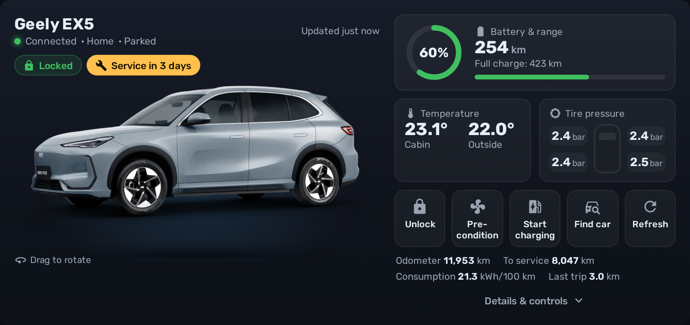
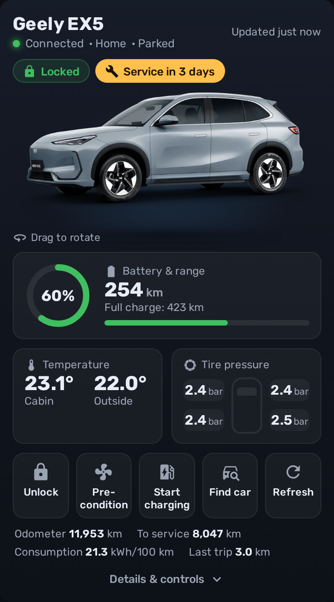
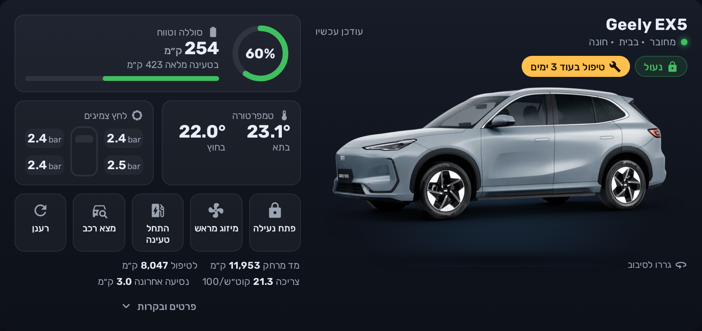

# Geely EX5 Card

A polished Lovelace card for the **Geely EX5** in Home Assistant, with a **drag-to-rotate 360° view** of the car, battery & range, charging, tire pressures, climate, lock and quick controls. Full **English** and **Hebrew (RTL)** UI.



## Features

- 360° car view: drag (mouse or touch) through 24 frames with momentum; vertical page scrolling still works on phones
- Battery ring (color by level), range and range at full charge
- Charging panel (power, time to full) – shown only while plugged in / charging
- Lock state with lock / unlock button (unlock asks for confirmation)
- Red warning chips for open doors, trunk, hood, windows and sunroof
- Service warning chip (days or km to service)
- Tire pressures in bar on a small top-view diagram, low pressure highlighted (psi / kPa / bar sensors are converted automatically)
- Cabin and outside temperature
- Quick actions: pre-conditioning on/off, start/stop charging (with confirmation), find car, refresh data
- Expandable details: seat heating & ventilation (driver/passenger), windows, sunroof, sunshade, defrost
- Tap any value to open the entity's more-info dialog
- "Last updated" relative time
- English (LTR) and Hebrew (RTL) – automatic from your HA language, or forced
- Light and dark theme, responsive (one column on phones, two columns on wide sections)
- Vanilla web component: no build step, no external dependencies

## Requirements

- Home Assistant 2024.x or newer
- The **Geely Connect** custom integration (domain `geely_connect`) with your EX5 added. The card only reads/controls the entities that integration creates.
- The car images (see [Car images](#car-images)) – they are **not** included in this repository.

## Installation

### HACS (custom repository)

1. HACS → ⋮ → **Custom repositories** → add `https://github.com/1immortal/geely-ex5-card`, category **Dashboard**.
2. Install **Geely EX5 Card**, then reload the browser.
3. HACS registers the resource `/hacsfiles/geely-ex5-card/geely-ex5-card.js` automatically.

### Manual

1. Copy `geely-ex5-card.js` to `/config/www/geely-ex5-card.js`.
2. Settings → Dashboards → ⋮ → **Resources** → add `/local/geely-ex5-card.js` as **JavaScript module**.
3. Reload the browser.

## Car images

The 24 frames come from geely.com's public 360° viewer and are copyrighted by Geely, so they are not distributed here. Use the included script to download them for your own use, crop the empty top area and convert them to 900 px transparent WebP (about 1 MB for all 24):

```bash
# colors: silver (light gray), grey, green, black, white
scripts/fetch-images.sh silver            # -> ./images/silver/1.webp … 24.webp
# or: python3 scripts/fetch_images.py silver ./images/silver   (needs Pillow)
```

Copy the folder to Home Assistant as `/config/www/geely-ex5/<color>/` (for example with the File editor / Samba / SSH add-on), so the files are served at `/local/geely-ex5/<color>/1.webp`. Then set `color: <color>` in the card config, or point `image_base` anywhere else you stored them.

Frame 1 is the front, frame 7 the left side, 13 the rear and 19 the right side.

## Configuration

Find your **entity prefix**: open any entity of the car, e.g. `lock.my_geely_ex5_1234_doors` → the prefix is `my_geely_ex5_1234` (everything between the domain and `_doors`).

| Option | Type | Default | Description |
|---|---|---|---|
| `type` | string | **required** | `custom:geely-ex5-card` |
| `entity_prefix` | string | **required** | Shared prefix of the car's entities, e.g. `my_geely_ex5_1234` |
| `language` | string | `auto` | `auto` (Hebrew if your HA language is Hebrew, otherwise English), `en` or `he` |
| `title` | string | `Geely EX5` | Card title |
| `climate_entity` | string | auto-detected | Pre-conditioning climate entity. Auto-detection looks for `climate.<prefix>_climate`, then any climate entity whose name matches the end of the prefix. Set it if detection picks nothing or the wrong entity |
| `color` | string | `silver` | Image folder name used by the default `image_base` |
| `image_base` | string | `/local/geely-ex5/<color>/` | URL folder that contains `1.webp` … `24.webp` |
| `image_ext` | string | `webp` | Image file extension |
| `frames` | number | `24` | Number of rotation frames |
| `start_frame` | number | `5` | Frame shown at rest (5 = three-quarter front) |
| `service_warning_days` | number | `14` | Show the service chip when days to service ≤ this |
| `service_warning_km` | number | `1000` | …or when distance to service ≤ this (km) |
| `low_tire_bar` | number | `2.3` | Tire pressure (bar) below which a tire is highlighted |

### Example

```yaml
type: custom:geely-ex5-card
entity_prefix: my_geely_ex5_1234
language: auto
color: silver
start_frame: 5
```

In a sections view the card takes the full width of its section; give the section `column_span: 2` or more for the two-column layout.

### Entities used

All are `<domain>.<entity_prefix>_<key>`; missing entities are simply hidden.

- `sensor`: `battery`, `electric_range`, `range_at_full_charge`, `charger_connection`, `charging_power`, `time_to_full_charge`, `interior_temperature`, `exterior_temperature`, `tire_pressure_fl/fr/rl/rr`, `days_to_service`, `distance_to_service`, `total_mileage`, `average_consumption`, `last_trip`, `engine_state`, `last_updated`, `car_reported_at`
- `binary_sensor`: `connected`, `charger_plug`, `door_driver`, `door_passenger`, `door_rear_left`, `door_rear_right`, `trunk`, `hood`
- `lock.…_doors`, `switch.…_charging`, `switch.…_defrost`, `cover.…_all_windows`, `cover.…_sunroof`, `cover.…_sunshade`, `select.…_seat_heat_driver/passenger`, `select.…_seat_vent_driver/passenger`, `button.…_find_car`, `button.…_refresh_data`, `device_tracker.…_location`, and the climate entity

## Screenshots

| English – dark | English – details open |
|---|---|
|  |  |

| English – phone | English – phone, light theme | Hebrew – phone |
|---|---|---|
|  |  |  |

Hebrew (RTL), desktop:



## עברית

כרטיס Lovelace ל-Geely EX5 עם תצוגת 360° בגרירה, סוללה וטווח, טעינה, לחץ צמיגים, טמפרטורה, נעילה ובקרות מהירות. הממשק זמין בעברית (מימין לשמאל) ובאנגלית.

- השפה נבחרת אוטומטית לפי שפת Home Assistant, או בכפייה עם `language: he`.
- נדרשת האינטגרציה Geely Connect. חובה להגדיר `entity_prefix`.
- תמונות הרכב אינן כלולות במאגר (זכויות יוצרים של Geely). הורידו אותן עם `scripts/fetch-images.sh` והעתיקו ל-`/config/www/geely-ex5/<צבע>/`.

```yaml
type: custom:geely-ex5-card
entity_prefix: my_geely_ex5_1234
language: he
```

## Disclaimer

Not affiliated with or endorsed by Geely. "Geely" and "EX5" are trademarks of their respective owners. Car images are © Geely and are fetched by the user; they are not part of this project or its license.

## License

[MIT](LICENSE) © 2026 1immortal
