# Geely 3D Card

[](https://my.home-assistant.io/redirect/hacs_repository/?owner=1immortal&repository=geely-3d-card&category=plugin)
[](https://github.com/1immortal/geely-3d-card/releases/latest)
[](https://github.com/hacs/integration)
[](LICENSE)

A polished Lovelace card for Geely cars in Home Assistant — drag-to-rotate 360° view, battery and range, charging, climate, tires, lock, and a pre-conditioning panel. Built for the **EX5**, and also supporting the **E5**, the **EX2 / E2 / EX2 Max**, and the **Starray EM-i (PHEV)**. Full **English** and **Hebrew (RTL)** UI, light and dark themes.

It is a front-end for the excellent **[Geely Connect](https://github.com/YossiKon/geely-connect)** integration by **[@YossiKon](https://github.com/YossiKon)** — all the car data and commands come from that integration.

<p align="center">
  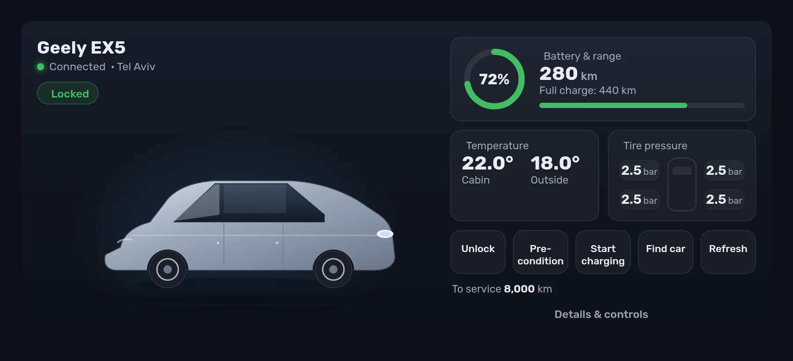
</p>

> **Unofficial.** This card is a community project. It is not affiliated with, endorsed by, or supported by Geely. Car images are © Geely, downloaded by you from [geely.com](https://www.geely.com/) / [geely.com.au](https://www.geely.com.au/) / [geely.de](https://www.geely.de/), and are not part of this repository. The screenshots below use a generic placeholder car and mocked data.

## Features

- 360° car view: drag (mouse or touch) through 24 frames with momentum; vertical page scrolling still works on phones
- Per-model profiles with automatic model detection (from the device in the device registry)
- Battery ring, electric range and range at full charge; **PHEV** fuel tile and combined range
- Charging panel (power, time to full) while plugged in, plus optional **Start / Stop** buttons for a wall charger in Home Assistant
- Lock / unlock (unlock asks for confirmation), warning chips for open doors, trunk, hood, windows, sunroof and fuel flap
- Tire pressures in **bar**, **psi** or **kPa**, cabin and outside temperature, service warning
- **Pre-conditioning** panel: temperature, Normal / Rapid Cooling / Rapid Warming, seats, defrost, scheduled start with a 24-hour picker
- **Find car** opens an in-card map (or honk & flash); optional car-shaped map pin
- English (LTR) and Hebrew (RTL), light and dark, one column on phones and two columns on wide sections
- Every block hides itself when the car does not have the entity — trims without a sunroof or ventilated seats just work
- Vanilla web component: no build step, no external dependencies

<p align="center">
  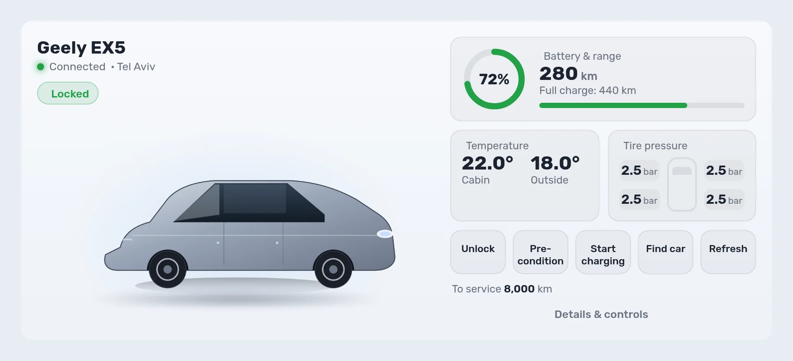
  &nbsp;
  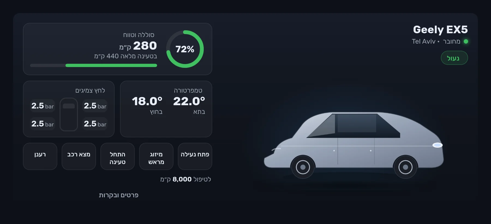
</p>
<p align="center">
  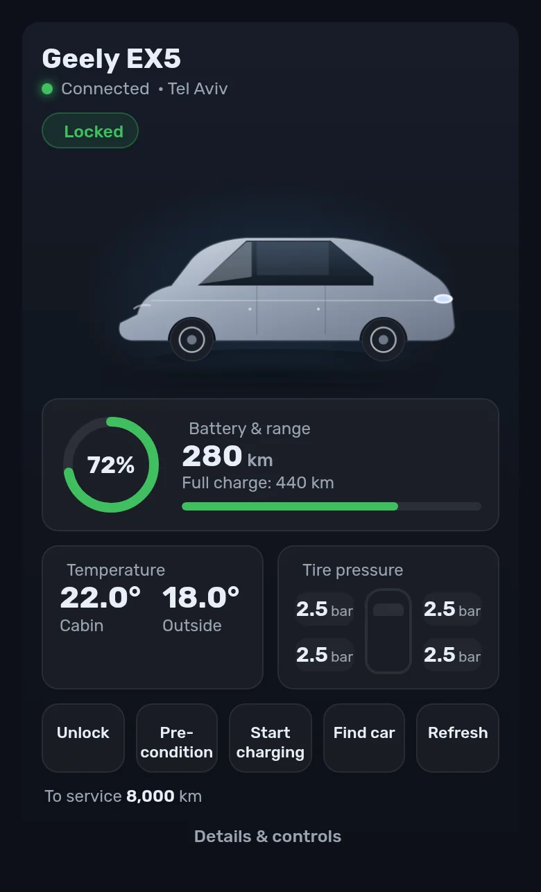
  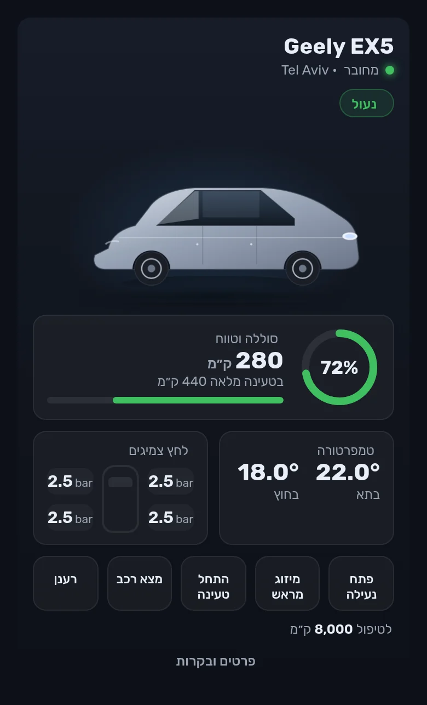
  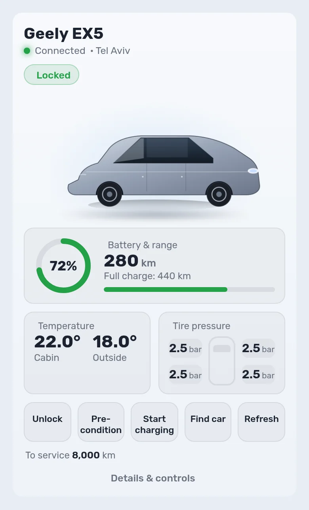
</p>

| Pre-conditioning | Find-car map | Charger controls |
| :---: | :---: | :---: |
| 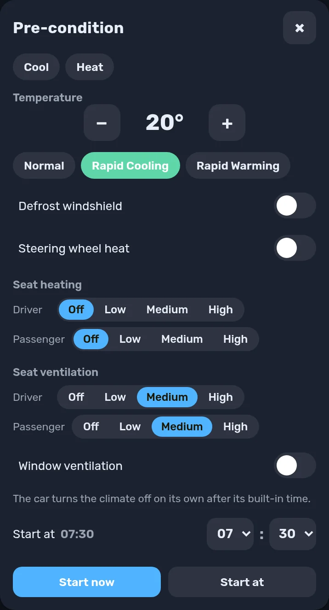 | 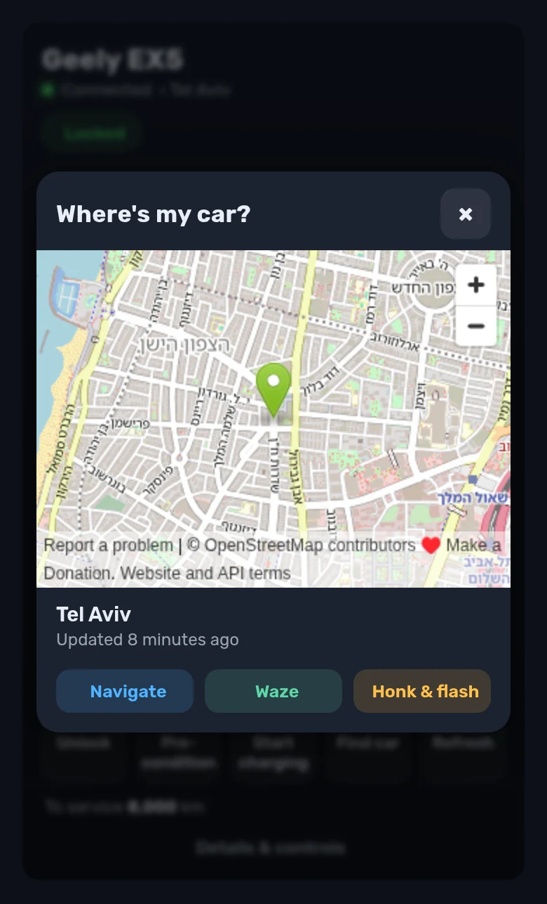 | 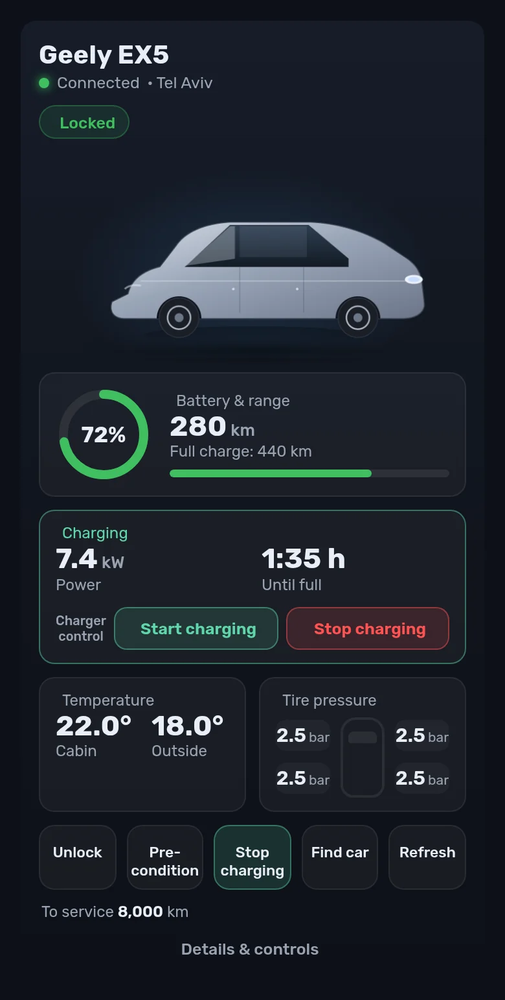 |

<p align="center">
  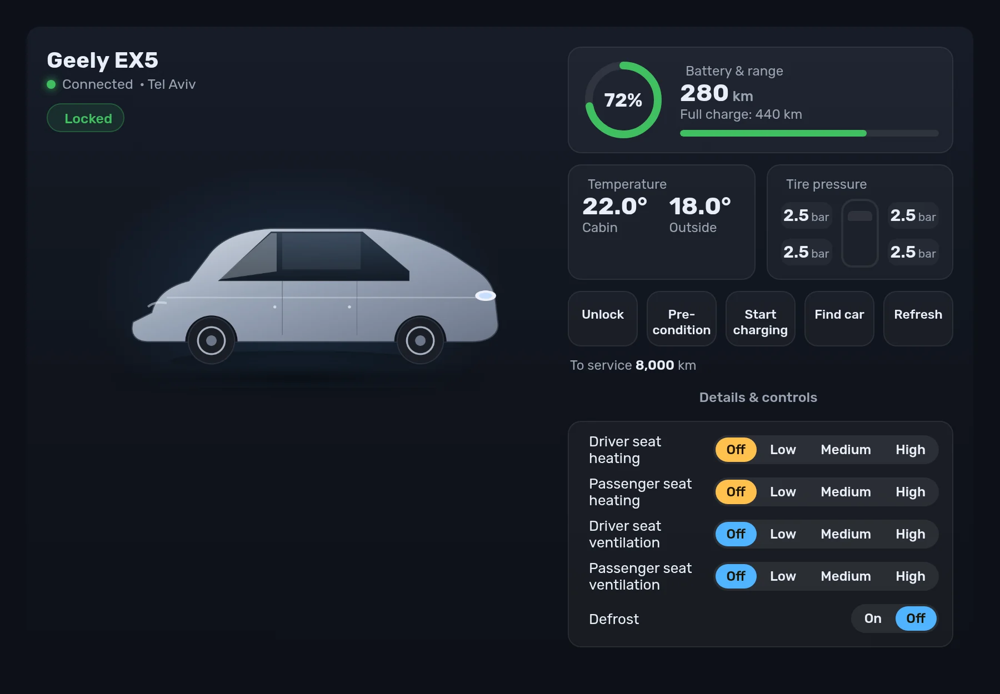
</p>

The pre-conditioning panel is also available in Hebrew (RTL), including the 24-hour **הפעל בשעה** picker:

<p align="center">
  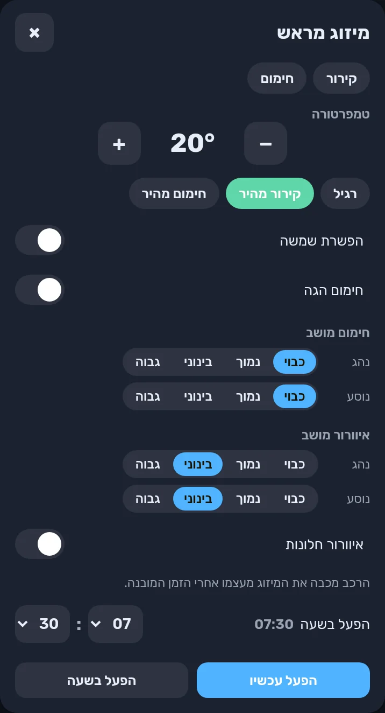
</p>

Screenshots use mocked Home Assistant data and a generic placeholder car (not official Geely photography). The map uses a fake Tel Aviv pin.

## Quick start

### Marketplace (Home Assistant 2026.11+)

[](https://my.home-assistant.io/redirect/hacs_repository/?owner=1immortal&repository=geely-3d-card&category=plugin)

Once the card is in the default catalog:

1. **Settings → Marketplace**, search for **Geely 3D Card**, open it, install it, then reload the browser.
2. The resource `/local/community/geely-3d-card/geely-3d-card.js` is registered automatically.

If it does not appear in search yet, add it by link: **Settings → Marketplace → Add from link**, enter `1immortal/geely-3d-card` (type **Dashboard**, if asked), then install as above.

### HACS (Home Assistant 2026.10 and older)

Once the card is in the default store, search for **Geely 3D Card** in HACS, install it, then reload the browser. HACS registers the resource `/hacsfiles/geely-3d-card/geely-3d-card.js` automatically.

If search does not find it, add it as a custom repository first: HACS → ⋮ → **Custom repositories** → add `https://github.com/1immortal/geely-3d-card`, category **Dashboard**, then install as above.

### Manual

1. Copy `geely-3d-card.js` to `/config/www/geely-3d-card.js`.
2. Settings → Dashboards → ⋮ → **Resources** → add `/local/geely-3d-card.js` as **JavaScript module**.
3. Reload the browser.

Then add the card to a dashboard with a minimal config. `entity_prefix` is the shared prefix of the car's entities from Geely Connect (without the domain):

```yaml
type: custom:geely-3d-card
entity_prefix: my_geely_ex5_1234
```

In a sections view the card takes the full width of its section. Give the section `column_span: 2` or more to get the two-column layout.

The previous type `custom:geely-ex5-card` is still registered as a backward-compatible alias, so existing dashboards keep working after the upgrade.

## Car images

The frames are © Geely, so they are not distributed here. The included script downloads them for your own use, crops them and converts them to 900 px WebP (about 0.4–1 MB per color):

```bash
scripts/fetch-images.sh --list                                   # models and their colors
scripts/fetch-images.sh --model ex5 --color silver               # -> ./images/ex5/silver/1.webp … 24.webp
scripts/fetch-images.sh --model e5 --color silver                # -> ./images/e5/silver/1.webp … 24.webp
scripts/fetch-images.sh --model ex2 --color star-silver          # --variant N picks another trim's set
scripts/fetch-images.sh --model starray_emi --color glacier-blue # --remove-background (experimental)
# or directly: python3 scripts/fetch_images.py … (needs Pillow)
```

Copy the folder to Home Assistant as **`/config/www/geely-ex5/<model>/<color>/`** (File editor, Samba or SSH add-on), so the files are served at `/local/geely-ex5/<model>/<color>/1.webp`. That is the card's default location for the detected `model` and `color`. If you store them anywhere else, set **`image_base`**.

EX5 and E5 frames: 1 = front, 7 = left side, 13 = rear, 19 = right side. The Geely Australia sets run the other way, and the profile handles that (`rotate_direction`).

## Supported models

The integration is owner-tested on the EX5, the EX2 (sold as the E2 in some markets, plus the EX2 Max) and the Starray PHEV (Starray EM-i), and is capability-driven, so other Geely models on the Geely Global / International app should work too ([integration README](https://github.com/YossiKon/geely-connect#readme)). The card mirrors that.

Set `model` if auto-detection picks the wrong profile: `ex5`, `e5`, `ex2`, `starray_emi` or `generic`. The **E5** is a separate model from the **EX5** — use `model: e5` and the E5 image set from `scripts/fetch-images.sh`.

## Configuration

### Full example

```yaml
type: custom:geely-3d-card
entity_prefix: my_geely_ex5_1234
language: auto        # auto, en or he
model: auto           # or ex5 / e5 / ex2 / starray_emi
color: silver
# Optional
tire_unit: bar        # bar, psi or kpa
# charge_start_entity: button.wall_charger_start
# charge_stop_entity: button.wall_charger_stop
# find_action: map    # or honk
# map_marker: car     # or default
# time_format: 24h    # or 12h; Hebrew defaults to 24h
# command_delay: 2    # seconds between pre-conditioning commands
precond_schedule_entity: input_datetime.geely_precond_time
precond_schedule_enabled_entity: input_boolean.geely_precond_scheduled
precond_settings_entity: input_text.geely_precond_settings
```

### Options

#### Core

| Option | Type | Default | Description |
|---|---|---|---|
| `type` | string | **required** | `custom:geely-3d-card` |
| `entity_prefix` | string | **required** | Shared prefix of the car's entities, e.g. `my_geely_ex5_1234` |
| `model` | string | `auto` | `auto`, `ex5`, `e5`, `ex2`, `starray_emi` or `generic`. Auto-detection reads the car's device (model / name) in the device registry, then the prefix |
| `language` | string | `auto` | `auto` (Hebrew if your HA language is Hebrew, otherwise English), `en` or `he` |
| `title` | string | model name | Card title |
| `climate_entity` | string | auto-detected | Pre-conditioning climate entity. Auto-detection looks for `climate.<prefix>_climate`, then any climate entity whose name matches the end of the prefix. Set it if detection picks nothing or the wrong entity |
| `service_warning_days` | number | `14` | Show the service chip when days to service ≤ this |
| `service_warning_km` | number | `1000` | …or when distance to service ≤ this (km) |

#### Images

| Option | Type | Default | Description |
|---|---|---|---|
| `color` | string | model default | Image folder name used by the default `image_base` |
| `image_base` | string | `/local/geely-ex5/<model>/<color>/` | URL folder that contains `1.webp` … `N.webp` |
| `image_ext` | string | `webp` | Image file extension |
| `frames` | number | model default (24) | Number of rotation frames; `1` = a single static image |
| `car_image` | string | – | URL of one image of your car. Disables rotation |
| `start_frame` | number | model default | Frame shown at rest (EX5: 5, the three-quarter front) |
| `rotate_direction` | number | model default | `1` or `-1`, if dragging turns your own frame set the wrong way |
| `image_background` | string | model default | Panel color behind non-transparent frames, e.g. `'#f5f3f1'`; `null` for none |

#### Tires

| Option | Type | Default | Description |
|---|---|---|---|
| `tire_unit` | string | `bar` | Display unit for tire pressures: `bar`, `psi` or `kpa`. Sensor values in any of those units are converted automatically |
| `low_tire_bar` | number | `2.3` | Tire pressure (bar) below which a tire is highlighted. Compared in bar internally, even when the display unit is psi or kPa |
| `low_tire_psi` | number | – | Optional low-pressure threshold in psi. Used only if `low_tire_bar` is not set |

#### Charger

| Option | Type | Default | Description |
|---|---|---|---|
| `charge_start_entity` | string | – | Optional. Entity that starts the wall charger (`button`, `switch`, `script` or `input_button`) |
| `charge_stop_entity` | string | – | Optional. Entity that stops the wall charger (same domains) |
| `charger_switch_entity` | string | – | Optional. A single `switch` used for both start (`turn_on`) and stop (`turn_off`). Used for a side if the matching start/stop entity is not set |

If you have a wall charger in Home Assistant, these options add Start/Stop charging buttons inside the charging bubble. This works with any charger integration that exposes a button, switch, script or `input_button` (for example BENY, Wallbox, OCPP or Easee). The car's own charging action button is unchanged. The car's plug sensor remains the source of truth for plugged / not plugged in. When charger control is configured and the car is unplugged, the bubble shows a muted “Not plugged in” / “לא מחובר למטען” status.

#### Map

| Option | Type | Default | Description |
|---|---|---|---|
| `location_entity` | string | auto-detected | Optional. Location entity used by the map (`device_tracker.<prefix>_location` is used if it exists) |
| `find_action` | string | `map` if a location entity exists, otherwise `honk` | `map` opens the in-card map; `honk` presses `button.<prefix>_find_car` as before |
| `map_marker` | string | `car` | `car` shows a small render of the card's 360° car on the in-card map pin (Home Assistant map card). `default` keeps the stock entity marker |
| `map_marker_frame` | number | the profile `start_frame` (EX5: 5, a three-quarter view) | 1-based frame number used for the car map marker |

Find car can open an in-card map with a pin at the car, plus Navigate, Waze, and optional Honk & flash (with confirmation). If no location entity exists, the button still honks as before.

#### Pre-conditioning

| Option | Type | Default | Description |
|---|---|---|---|
| `command_delay` | number | `2` | Seconds to wait between pre-conditioning commands sent to the car. The Geely cloud accepts only one remote command at a time. `0` disables the gap and the retry backoffs. Writes to schedule helpers (`input_*`) stay sequential but skip this delay |
| `time_format` | string | auto | `24h` or `12h` for clock times in the card (including the scheduled-start label). If omitted, Hebrew defaults to 24-hour time and other languages follow Home Assistant's locale `time_format`. The Start-at picker itself is always 24-hour |
| `precond_entities` | list | auto-detected | Optional extra `switch` / `select` entities to show in the pre-conditioning panel. Auto-detected controls (`defrost`, `steering_wheel_heat`, `window_ventilation`, `seat_heat_*`, `seat_vent_*`) that do not exist are hidden. An entry that matches one of those suffixes overrides the auto-detected entity |
| `precond_schedule_entity` | string | – | Optional `input_datetime` (time only). Together with `precond_schedule_enabled_entity`, enables **Start at** in the panel |
| `precond_schedule_enabled_entity` | string | – | Optional `input_boolean` that arms the scheduled start |
| `precond_settings_entity` | string | – | Optional `input_text` (max 255) where the panel stores a compact JSON of the chosen settings for a scheduled start |

Tapping **Pre-condition** opens an in-card panel instead of immediately toggling the climate entity. You can set the target temperature (0.5° steps, within the climate entity's min/max), pick **Normal** or a Rapid Cooling / Rapid Warming preset when the car exposes them, and toggle defrost, steering-wheel heat, window ventilation, and seat heat / ventilation (Off / Low / Medium / High). Controls are auto-detected from `entity_prefix` and hidden when the entity does not exist. Use `precond_entities` to add or override extra `switch` or `select` entities.

Quick presets (**Cool** / **Heat**, or **קירור** / **חימום** in Hebrew) only prefill the form:

- Cool: 20°, Rapid Cooling, seat ventilation Medium
- Heat: 25°, Rapid Warming, seat heating Medium, steering-wheel heat, defrost

**Start now** asks for confirmation (it starts the car's climate remotely), then sends commands **one at a time**: `climate.set_temperature` with `hvac_mode: heat_cool`, `climate.set_preset_mode` if a rapid preset is selected and is not already active, then only the switches and selects that need to change. Accessories already in the desired state are skipped, and an accessory that is `unknown` or `unavailable` is not turned off (turning it on is still sent). The card waits `command_delay` seconds (default 2) between commands, because the Geely cloud accepts only one remote request at a time. If a call fails with “the last request has not yet been executed / send the command later”, it is retried up to three times (3s, 6s, 10s). Home Assistant's raw error toasts are suppressed; the panel shows progress (`Sending 2/4…` / `שולח 2/4…`) and, if something still fails, which items failed. Buttons stay visible but disabled while sending.

If the climate is already on, a **Stop** button turns HVAC off first, then only the accessories that are currently on. The panel notes that the car turns the climate off on its own after its built-in time.

The card cannot fire a delayed start while it is closed, so a scheduled start needs helpers on the Home Assistant side. Configure an `input_datetime` (time only), an `input_boolean`, and optionally an `input_text` (max 255 characters) as shown below. **Start at** uses a 24-hour hour / minute picker (hours 00–23, minutes in 5-minute steps). If a schedule is already armed, the picker opens on the helper's time (snapped to 5 minutes); otherwise it defaults to the next full hour plus one, or 07:30 if the clock is unavailable. Clock times in the card (including the scheduled-time label) use `time_format` when set; if it is omitted, Hebrew defaults to 24-hour time and other languages follow Home Assistant's locale. **Start at** then writes the next occurrence's time, turns the boolean on, and stores compact JSON in the text helper (`t`, `p`, `df`, `wh`, `wv`, `shd`, `shp`, `svd`, `svp`, plus `e` for extras). If those helpers are not configured, **Start at** is hidden.

```yaml
type: custom:geely-3d-card
entity_prefix: my_geely_ex5_1234
precond_schedule_entity: input_datetime.geely_precond_time
precond_schedule_enabled_entity: input_boolean.geely_precond_scheduled
precond_settings_entity: input_text.geely_precond_settings
# precond_entities:
#   - switch.my_extra_climate_accessory
```

Example helpers (Helpers in the UI, or YAML):

```yaml
input_datetime:
  geely_precond_time:
    name: Geely pre-conditioning time
    has_date: false
    has_time: true

input_boolean:
  geely_precond_scheduled:
    name: Geely pre-conditioning scheduled

input_text:
  geely_precond_settings:
    name: Geely pre-conditioning settings
    max: 255
```

<details>
<summary>Sample schedule automation</summary>

Sample automation. It runs at the helper time only if the boolean is on, validates the JSON before applying it, then turns the boolean off. Commands are sent one at a time with a 2 second delay, accessories already at the desired state are skipped (an `unknown` / `unavailable` switch is not turned off), accessory steps use `continue_on_error`, and a command is retried with backoff only while the entity stays in a known wrong state — not when it stays `unknown` after a send (steering-wheel heat is often `unknown`). Replace the climate / switch / select entity ids with yours. Mode is `single`.

```yaml
alias: Geely pre-conditioning schedule
id: geely_precond_schedule
mode: single
trigger:
  - platform: time
    at: input_datetime.geely_precond_time
condition:
  - condition: state
    entity_id: input_boolean.geely_precond_scheduled
    state: "on"
action:
  - action: input_boolean.turn_off
    target:
      entity_id: input_boolean.geely_precond_scheduled
  - variables:
      raw: "{{ states('input_text.geely_precond_settings') }}"
      cfg: "{{ raw | from_json(default=none) }}"
      extras: >-
        {{ (cfg.e if cfg is mapping and cfg.e is list else [])
           | selectattr(0, 'string')
           | map('list')
           | list }}
  - condition: template
    value_template: "{{ cfg is mapping and cfg.t is number }}"
  - action: climate.set_temperature
    continue_on_error: true
    target:
      entity_id: climate.my_geely_ex5_1234_climate
    data:
      temperature: "{{ cfg.t }}"
      hvac_mode: heat_cool
  - delay:
      seconds: 2
  - if:
      - condition: template
        value_template: "{{ cfg.p is string and cfg.p not in ['', 'none', 'auto'] and state_attr('climate.my_geely_ex5_1234_climate', 'preset_mode') != cfg.p }}"
    then:
      - action: climate.set_preset_mode
        continue_on_error: true
        target:
          entity_id: climate.my_geely_ex5_1234_climate
        data:
          preset_mode: "{{ cfg.p }}"
      - delay:
          seconds: 2
  - repeat:
      for_each: >
        
        
          
        
        
          
        
        
          
        
        
          
        
        
          
        
        
          
        
        
          
        
        
          
            
          
        
        {{ ns.items }}
      sequence:
        - variables:
            eid: "{{ repeat.item.id }}"
            kind: "{{ repeat.item.kind }}"
            want: "{{ repeat.item.want }}"
            want_on: "{{ want not in [false, 0, '0', none, ''] }}"
            desired: "{{ 'on' if kind == 'switch' and want_on else ('off' if kind == 'switch' else want) }}"
            cur: "{{ states(eid) | lower if kind == 'switch' else states(eid) }}"
            skip: >-
              {{ (kind == 'switch' and ((cur in ['unknown', 'unavailable'] and not want_on) or cur == desired))
                 or (kind == 'select' and (want is not string or cur == want))
                 or kind not in ['switch', 'select'] }}
        - if:
            - condition: template
              value_template: "{{ not skip }}"
          then:
            - if:
                - condition: template
                  value_template: "{{ kind == 'switch' }}"
              then:
                - action: "switch.turn_{{ 'on' if want_on else 'off' }}"
                  continue_on_error: true
                  target:
                    entity_id: "{{ eid }}"
              else:
                - action: select.select_option
                  continue_on_error: true
                  target:
                    entity_id: "{{ eid }}"
                  data:
                    option: "{{ want }}"
            - delay:
                seconds: 3
            - if:
                - condition: template
                  value_template: "{{ states(eid) not in ['unknown', 'unavailable'] and ((kind == 'switch' and states(eid) | lower != desired) or (kind == 'select' and states(eid) != want)) }}"
              then:
                - if:
                    - condition: template
                      value_template: "{{ kind == 'switch' }}"
                  then:
                    - action: "switch.turn_{{ 'on' if want_on else 'off' }}"
                      continue_on_error: true
                      target:
                        entity_id: "{{ eid }}"
                  else:
                    - action: select.select_option
                      continue_on_error: true
                      target:
                        entity_id: "{{ eid }}"
                      data:
                        option: "{{ want }}"
                - delay:
                    seconds: 6
                - if:
                    - condition: template
                      value_template: "{{ states(eid) not in ['unknown', 'unavailable'] and ((kind == 'switch' and states(eid) | lower != desired) or (kind == 'select' and states(eid) != want)) }}"
                  then:
                    - if:
                        - condition: template
                          value_template: "{{ kind == 'switch' }}"
                      then:
                        - action: "switch.turn_{{ 'on' if want_on else 'off' }}"
                          continue_on_error: true
                          target:
                            entity_id: "{{ eid }}"
                      else:
                        - action: select.select_option
                          continue_on_error: true
                          target:
                            entity_id: "{{ eid }}"
                          data:
                            option: "{{ want }}"
                    - delay:
                        seconds: 10
                    - if:
                        - condition: template
                          value_template: "{{ states(eid) not in ['unknown', 'unavailable'] and ((kind == 'switch' and states(eid) | lower != desired) or (kind == 'select' and states(eid) != want)) }}"
                      then:
                        - if:
                            - condition: template
                              value_template: "{{ kind == 'switch' }}"
                          then:
                            - action: "switch.turn_{{ 'on' if want_on else 'off' }}"
                              continue_on_error: true
                              target:
                                entity_id: "{{ eid }}"
                          else:
                            - action: select.select_option
                              continue_on_error: true
                              target:
                                entity_id: "{{ eid }}"
                              data:
                                option: "{{ want }}"
            - delay:
                seconds: 2
```

If `from_json` cannot parse the helper (invalid or empty JSON), the `cfg.t is number` condition fails and nothing is sent to the car.

</details>

### Entities used

All are `<domain>.<entity_prefix>_<key>`. Missing entities are simply hidden.

- `sensor`: `battery`, `electric_range`, `range_at_full_charge`, `charger_connection`, `charging_power`, `time_to_full_charge`, `interior_temperature`, `exterior_temperature`, `tire_pressure_fl/fr/rl/rr`, `days_to_service`, `distance_to_service`, `total_mileage`, `average_consumption`, `last_trip`, `engine_state`, `last_updated`, `car_reported_at`; PHEV: `fuel_level`, `fuel_level_percent`, `fuel_range`, `combined_range`
- `binary_sensor`: `connected`, `charger_plug`, `door_driver`, `door_passenger`, `door_rear_left`, `door_rear_right`, `trunk`, `hood`; PHEV: `fuel_flap`
- `lock.…_doors`, `switch.…_charging`, `switch.…_defrost`, `switch.…_steering_wheel_heat`, `switch.…_window_ventilation`, `cover.…_all_windows`, `cover.…_sunroof`, `cover.…_sunshade`, `select.…_seat_heat_*` / `select.…_seat_vent_*` (driver, passenger, rear_left, rear_right), `button.…_find_car`, `button.…_refresh_data`, `button.…_unlock_trunk`, `button.…_unlock_frunk`, `device_tracker.…_location`, and the climate entity

## FAQ / troubleshooting

**A toast says “the last request has not yet been executed / send the command later.”**  
The Geely cloud accepts only one remote command at a time. From v1.7.3 the card sends pre-conditioning commands sequentially, waits `command_delay` (default 2 seconds), skips accessories that are already in the desired state, and retries that busy error up to three times. If a command still fails, the panel lists which items failed instead of showing Home Assistant's raw toast. Give the car a few seconds between any other remote commands (the official app, automations, or a previous Start now).

**The card looks stale, or a new version does not appear after updating.**  
Home Assistant and the browser cache the JavaScript module. After a HACS / Marketplace update, reload the browser with a hard refresh (on a phone: close the HA app and reopen it, or clear the cache). If you added the card as a manual resource, bump the `?v=` query string on the resource URL.

**Is the E5 the same as the EX5?**  
No. They are related but use different model profiles and image sets. Use `model: e5` (or let auto-detection pick it from the device) and fetch the E5 frames with `scripts/fetch-images.sh --model e5 --color silver`. The EX5 profile and `geely.com` image set will look wrong on an E5.

**Start at is missing, or the time field showed 12:00 AM.**  
**Start at** is shown only when `precond_schedule_entity` and `precond_schedule_enabled_entity` are configured. The time picker is always 24-hour (hours 00–23, minutes in 5-minute steps), so it no longer follows the phone's 12-hour locale. If a schedule is not already armed, the default is the next full hour plus one, not midnight.

**The map pin is initials, not the car.**  
The car pin is hooked into Home Assistant's map engine after render. If that engine cannot be hooked within a couple of seconds, the stock marker is kept. The OpenStreetMap iframe fallback never uses a custom pin. Set `map_marker: default` if you prefer the stock pin.

**Unlock / climate / honk did nothing.**  
Those actions ask for confirmation first (a red confirm dialog). Remote climate start also needs the car to be reachable in Geely's cloud; check the Geely Connect integration if entities are `unavailable`.

## Credits

- **Integration:** [Geely Connect](https://github.com/YossiKon/geely-connect) (`geely_connect`) by [@YossiKon](https://github.com/YossiKon) — the unofficial Home Assistant integration that talks to Geely's cloud and creates every entity this card reads and controls. Issues with data or commands belong in [its issue tracker](https://github.com/YossiKon/geely-connect/issues). Per its source, its protocol mappings build in part on [nitaybz/geely-global-ha](https://github.com/nitaybz/geely-global-ha).
- **Car images:** the 360° frames come from Geely's own websites — [geely.com](https://www.geely.com/en/models/ex5) (EX5), Geely Europe's [geely.de](https://www.geely.de/models/geely-e5-electric-suv) (E5) and [geely.com.au](https://www.geely.com.au/) (EX2, Starray EM-i). They are © Geely and are fetched locally by `scripts/fetch-images.sh`; they are not redistributed here.
- **Icons:** [Material Design Icons](https://pictogrammers.com/library/mdi/) via Home Assistant's `ha-icon`.

## עברית

כרטיס Lovelace לרכבי Geely (EX5, ‏E5, ‏EX2/E2 ו-Starray EM-i) עם תצוגת 360° בגרירה, סוללה וטווח, דלק (בפלאג-אין), טעינה, לחץ צמיגים, טמפרטורה, נעילה ובקרות מהירות. הממשק זמין בעברית (מימין לשמאל) ובאנגלית.

- הנתונים מגיעים מהאינטגרציה [Geely Connect](https://github.com/YossiKon/geely-connect) של [@YossiKon](https://github.com/YossiKon). חובה להגדיר `entity_prefix`.
- השפה נבחרת אוטומטית לפי שפת Home Assistant, או בכפייה עם `language: he`.
- דגם הרכב מזוהה אוטומטית. אפשר לקבוע אותו ידנית עם `model`.
- תמונות הרכב אינן כלולות במאגר (זכויות יוצרים של Geely). הורידו אותן עם `scripts/fetch-images.sh` והעתיקו ל-`/config/www/geely-ex5/<דגם>/<צבע>/`.
- «מצא רכב» פותח מפה עם מיקום הרכב. «מיזוג מראש» פותח לוח להגדרת טמפרטורה, קירור/חימום מהיר, מושבים והפשרה, עם «הפעל עכשיו» או «הפעל בשעה» (בורר 24 שעות).
- כרטיס לא רשמי, ללא קשר ל-Geely.

```yaml
type: custom:geely-3d-card
entity_prefix: my_geely_ex5_1234
language: he
```

## Changelog

### 1.7.4
- The **Start at** hour / minute picker (and clock times shown as text) always display as `HH : MM` from left to right, including in Hebrew RTL. The label stays in the page direction; the time itself is isolated as LTR.

### 1.7.3
- Pre-conditioning commands are sent one at a time with a configurable `command_delay` (default 2 seconds). Accessories already in the desired state are skipped, and an `unknown` / `unavailable` accessory is not turned off. A Geely “last request has not yet been executed / send the command later” error is retried up to three times (3s, 6s, 10s). The panel shows progress and a clear final status; Home Assistant's raw error toasts are suppressed. **Stop** turns HVAC off first, then only accessories that are currently on. The sample schedule automation in this README follows the same rules.
- **Start at** uses a 24-hour hour / minute picker (minutes in 5-minute steps) instead of the browser's locale-dependent time input. If a schedule is not already armed, the default time is the next full hour plus one (or 07:30). Optional `time_format: 24h` / `12h` controls other clock labels in the card; Hebrew defaults to 24-hour time, otherwise Home Assistant's locale is followed.

### 1.7.2
- The Find-car map uses a small render of the card's car as the pin on Home Assistant's map card (instead of the default entity initials). Configurable with `map_marker` (`car` / `default`) and `map_marker_frame`. If the map engine cannot be hooked, the stock marker is kept. The OpenStreetMap iframe fallback is unchanged.

### 1.7.1
- The pre-conditioning panel's no-preset chip is labelled **Normal** / **רגיל** (was Auto / אוטו). Behaviour is unchanged.

### 1.7.0
- The Pre-condition action opens an in-card panel: temperature stepper, Normal / Rapid Cooling / Rapid Warming, defrost, steering-wheel heat, window ventilation, and seat heat / ventilation. Cool and Heat chips prefill the form. **Start now** confirms, then applies `climate.set_temperature` (`hvac_mode: heat_cool`), an optional preset, and the chosen accessories. **Stop** appears when the climate is already on.
- Optional scheduled start via `precond_schedule_entity`, `precond_schedule_enabled_entity` and `precond_settings_entity`. A sample automation in this README reads the compact JSON at the chosen time (after validating it) and turns the schedule off. Extra accessories can be added with `precond_entities`.

### 1.6.0
- Find car can open an in-card map with a pin at the car, plus Navigate, Waze, and optional Honk & flash (with confirmation). Default is the map when `device_tracker.<prefix>_location` (or `location_entity`) is available; `find_action: honk` keeps the previous behaviour. If no location entity exists, the button still honks as before.

### 1.5.1
- Optional `tire_unit: bar` (default) / `psi` / `kpa` for the tire-pressure display. Sensors in psi, bar or kPa are converted automatically. `low_tire_bar` is still compared in bar; `low_tire_psi` can be used instead if you prefer to set the threshold in psi.

### 1.5.0
- Optional charger control: configure `charge_start_entity` and `charge_stop_entity` (a `button`, `switch`, `script` or `input_button`), or a single `charger_switch_entity`. Start/Stop buttons appear in the charging bubble, with confirmation. Works with any charger integration in Home Assistant (for example BENY, Wallbox, OCPP or Easee). The car's own charging action is unchanged.
- When charger control is configured and the car is unplugged, the bubble shows a muted “Not plugged in” / “לא מחובר למטען” status. The car's plug sensor is the source of truth.
- If those options are omitted, the card renders exactly as before.

### 1.4.1
- Escape card-config values interpolated into HTML, and validate `entity_prefix` and `*_entity` keys in `setConfig`.
- README install section leads with Marketplace / HACS catalog search.

### 1.4.0
- Geely E5 360° support, and a fix for the `geely-ex5-card` compatibility alias.

Full release notes: [GitHub Releases](https://github.com/1immortal/geely-3d-card/releases).

## Disclaimer

Unofficial project, not affiliated with or endorsed by Geely. "Geely", "EX5", "E5", "EX2" and "Starray" are trademarks of their respective owners. Car images are © Geely and are fetched by the user. They are not part of this project or its license.

## License

[MIT](LICENSE) © 2026 1immortal

## License

[MIT](LICENSE) © 2026 1immortal
